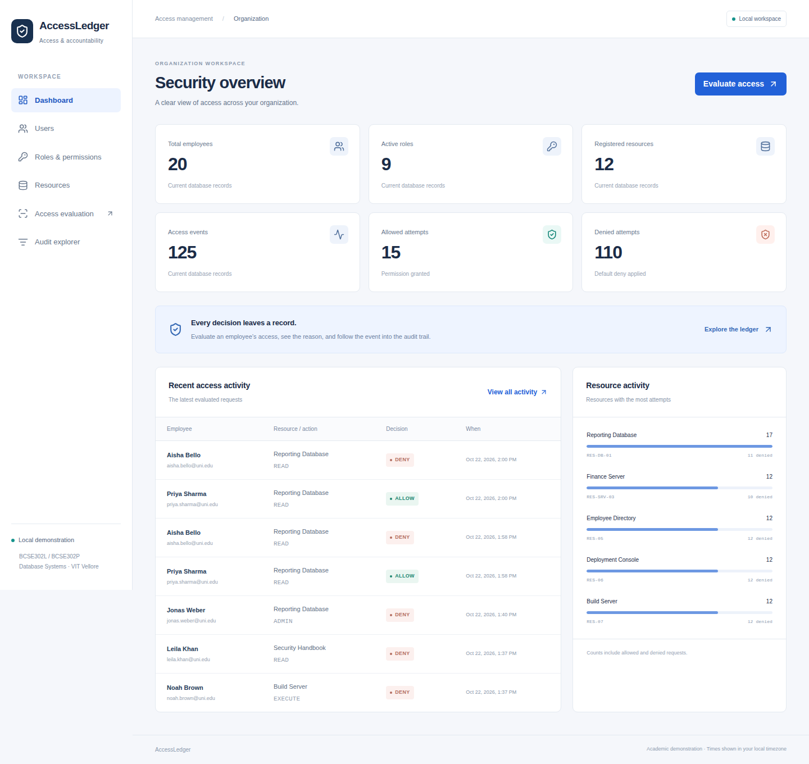

# AccessLedger

**A role-based access control and security audit management system.**

Database Systems — BCSE302L / BCSE302P, VIT Vellore. PostgreSQL owns authorization, constraints, transactions and audit recording; the FastAPI API and React interface demonstrate those capabilities.



## Start locally (Linux / WSL, Python 3.12+)

```bash
python3 -m venv .venv
.venv/bin/python -m pip install -r requirements.txt
./scripts/bootstrap-postgres.sh
./scripts/bootstrap-node.sh
export PATH="$PWD/.tools/node/current/bin:$PATH"
npm --prefix frontend ci
.venv/bin/python scripts/setup-db.py
./scripts/dev.sh
```

Open [the application](http://127.0.0.1:5173) and [interactive API docs](http://127.0.0.1:8000/docs). The API binds to 127.0.0.1:8000 and Vite to 127.0.0.1:5173. Stop both with Ctrl+C. The private PostgreSQL server remains running; stop it with `source scripts/db-env.sh` then `pg_ctl -D .pgdata stop -m fast`.

The PostgreSQL bootstrap reuses an existing cluster and starts it only when stopped. It requires unprivileged `apt-get download`, `dpkg-deb` and PostgreSQL 16 packages if the local runtime is missing. Node bootstrap installs verified Node 22.23.4 LTS Linux x64 into the Linux user's cache, which avoids slow WSL Windows-filesystem extraction. An already installed suitable Node LTS can be used instead. Python/Node dependencies are pinned in requirements.txt and package-lock.json.

Normal setup creates `accessledger_demo`, applies outstanding Alembic migrations and seeds only an empty database. It never drops existing data. The earlier `accessledger` database and `docs/evidence/phase1-run.md` are preserved. **That historical file is not current test evidence.**

## Docker PostgreSQL alternative

```bash
docker compose up -d --wait
export PGHOST=127.0.0.1 PGPORT=55432 PGUSER=postgres
export PGPASSWORD=local-owner-only
.venv/bin/python scripts/setup-db.py
./scripts/dev.sh
```

Stop the private cluster first if it already occupies port 55432. Compose binds PostgreSQL to loopback and stores data in a named volume. Set POSTGRES_PASSWORD and APP_DB_PASSWORD before setup to override demonstration passwords; copy .env.example to .env for persistent local configuration. `PGPASSWORD` is the migration administrator password; the API independently uses APP_DB_USER/APP_DB_PASSWORD or DATABASE_URL. Do not configure the API with administrator credentials. For TCP verification, export PGHOST, PGPORT, PGUSER, PGPASSWORD and APP_DB_PASSWORD in the shell as shown; `scripts/db-env.sh` is the private socket helper. Compose is provided but was not executed on this WSL host because Docker integration is unavailable.

## Demonstrate the application

1. **Users:** create an employee in Computer Science.
2. **Roles & permissions:** create a role, select the employee, assign the role, select that role and grant **Reporting Database · READ**.
3. **Access evaluation:** select the employee, Reporting Database and READ. Observe ALLOW, its reason and audit event ID.
4. **Roles & permissions:** select the same employee and revoke that role.
5. **Access evaluation:** repeat the same request. Observe DENY, then find both decisions in **Audit explorer**.

Priya Sharma already has Reporting Database READ through multiple active roles; Aisha Bello is disabled, Chen Wei has no roles, Legacy Contractor is inactive, and Legacy Archive is an inactive resource. Seeded Rahul Verma has an ALLOW → revoke → DENY history. Every valid evaluation adds a distinct event; no core UI behavior is mocked.

## Run verification

```bash
# All automated checks, executed SQL, benchmark and printable report:
./scripts/verification/run-all.sh

# Or individual checks:
PGDATABASE=accessledger_test ./scripts/reset-db.sh
PGDATABASE=accessledger_test .venv/bin/python -m pytest -v
npm --prefix frontend run build
PGDATABASE=accessledger_test_browser .venv/bin/python scripts/setup-db.py
npm --prefix frontend test
```

For browsers install once with `.venv/bin/python -m playwright install chromium` (Linux browser system libraries must be available). Current frontend and Python Playwright lock versions use Chromium revision 1248. The browser suite starts its own API/Vite servers on 8001/5174 and uses `accessledger_test_browser`; keep those ports free. Python tests refuse non-test databases. Only `accessledger_test*` and `accessledger_bench*` databases can be reset. No reset command targets the original or live demo database.

Capture genuine application screenshots while `scripts/dev.sh` is running with `.venv/bin/python scripts/verification/screenshots.py`. This performs two actual evaluations in the demo and records their events. Regenerate the printable report afterward with `.venv/bin/python scripts/verification/build-report.py`.

## Inspect SQL and the design

```bash
source scripts/db-env.sh
psql -X -v ON_ERROR_STOP=1 -f database/queries/010_required_catalog.sql
psql -X -v ON_ERROR_STOP=1 -f database/queries/020_basic_sql.sql
psql -X -c 'SELECT * FROM generate_access_activity_summary();'
```

Use `psql -v user_id=... -v permission_id=... -v department_id=...` to choose catalog parameters. Q13 also accepts `-v date_from=2026-10-01T00:00:00Z -v date_to=2026-11-01T00:00:00Z`; the default interval is the last seven days. The SQL-only baseline can be installed on a separately created empty demo/test database using `scripts/apply-sql.sh`; this is an alternative to Alembic, not a step before `setup-db.py`. It intentionally fails rather than overwriting populated schemas.

- [Final academic report](docs/final-report.md) / [printable PDF](docs/final-report.pdf)
- [Faculty requirement checklist](docs/requirements.md)
- [ER diagram](docs/er-diagram.svg), [relational schema](docs/relational-schema.md), [normalization](docs/normalization.md)
- [Architecture](docs/architecture.md), [transactions and concurrency](docs/transactions.md)
- [Actual testing results](docs/testing.md), [measured indexing results](docs/indexing.md)
- [Demonstration walkthrough](docs/demonstrations.md), [current evidence](docs/evidence/current)

## Database boundary

Exactly eight core relations: DEPARTMENT, APP_USER, ROLE, USER_ROLE, RESOURCE, PERMISSION, ROLE_PERMISSION and ACCESS_LOG. Alembic's version metadata lives separately in infrastructure. SQL files executed by versioned Alembic migrations are the single schema source; SQLAlchemy supplies Python connectivity rather than a second DDL definition. Verified revisions and their referenced SQL are immutable; future changes require another revision.

`evaluate_access(user_id, permission_id)` is the authoritative decision function. Valid references produce exactly one event; unknown references return DENY without a misleading log row. The API commits before returning a successful result. Application clients cannot supply a decision/reason or directly insert audit rows. Shared advisory transaction locks allow simultaneous evaluations; exclusive locks serialize all controlled policy changes against evaluations under READ COMMITTED.

Append-only triggers protect logs; a separate trigger freezes logged permission resource/action identities. Deactivation and revocation preserve old decisions. Joined names/departments are current labels, not historical snapshots. The generated decision column prevents inconsistent reason/decision pairs, but its functional dependency remains an explicitly documented 3NF/BCNF exception.

This is a trusted local academic authorization demonstration. It has no production authentication, administrator authorization, external IAM or enforcement on real resources. The socket-only private cluster trusts local users; a database superuser can bypass triggers. These are documented boundaries, not claims of production readiness.
