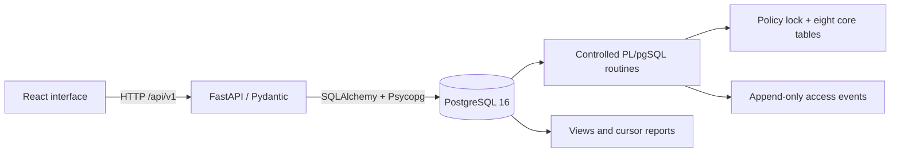

# Architecture

React + TypeScript + Vite + Tailwind renders six local pages. SWR caches server reads, paginates selection options when necessary, and revalidates them after policy/metadata mutations. Tables have loading, empty and failure states. The browser never calculates authorization outcomes.

The API is synchronous and uses a bounded SQLAlchemy pool (5 connections plus 5 overflow). Writes use explicit transaction contexts that commit before the handler returns; reads use short connection contexts. Database errors map to HTTP validation/not-found/conflict/unavailable responses without exposing SQL or credentials. Each valid evaluation produces one committed audit event; every repeated request is another attempt. Unknown references produce an unlogged denial and 404.

The API connects as accessledger_demo_app, never as postgres. Its SELECT access supports ordinary parameterized queries; state changes go through controlled routines. Routine ownership, public execution revocations, a trusted search_path and denial of direct policy/audit DML form the database boundary. SQL migrations run administratively and have separate credentials. The database owns authorization logic, generated decision consistency, keys, FKs and historical protections.

Vite proxies /api to loopback FastAPI during development. The built frontend can be previewed with the same proxy configuration; production hosting is outside scope. No external services, IAM federation, multi-tenancy, role inheritance, direct user grants, approvals, AI analysis or production-resource enforcement are included. This trusted local administration UI deliberately has no login/authentication system.

API docs: http://127.0.0.1:8000/docs. Endpoint contract and typed request/response definitions are inspectable through OpenAPI. Audit date filters require timezone-aware instants and use an inclusive start and exclusive end. Results order by timestamp and log ID descending; pagination uses items/total/limit/offset. Joined label fields always show current names/departments, not historical snapshots.
