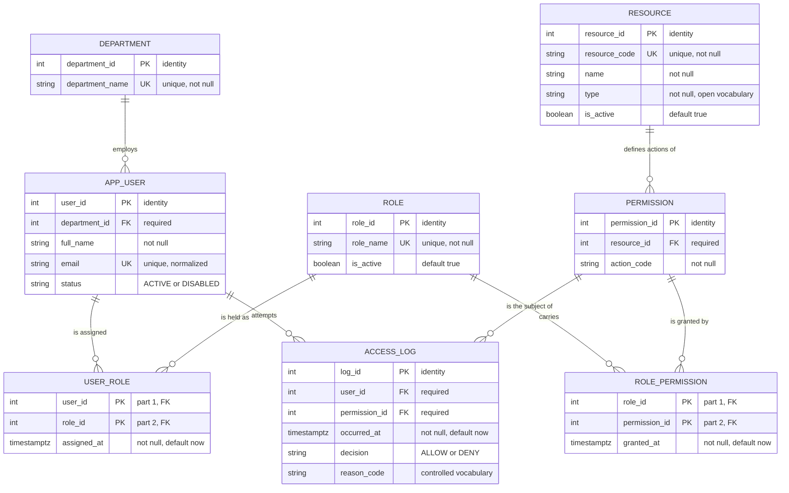

# AccessLedger — ER Diagram

Complete Crow's Foot model of the eight relations. Renders on GitHub, VS Code and most
Mermaid viewers with no extra tooling.



## Notation

`||` exactly one · `o{` zero or many · `PK` primary key · `FK` foreign key · `UK` unique

Every link is one-to-zero-or-more: a child references exactly one parent, and a parent may
have no children at all. Every diagrammed foreign key is `NOT NULL` and every one uses
`ON DELETE RESTRICT`, so a parent referenced by an assignment or an audit event cannot be
deleted — only deactivated.

## Reading the two junction relations

`USER_ROLE` and `ROLE_PERMISSION` each sit between two master relations because they resolve
a many-to-many relationship. They carry no descriptive data: their only non-key attribute is a
timestamp, and it depends on the *whole* composite key. That is exactly what the 2NF analysis
in `normalization.md` §2 requires, and it is why deleting a row from either table is a clean
revocation rather than an update to a flag.

```mermaid
graph LR
    U["APP_USER"] -- "USER_ROLE" -- R["ROLE"]
    R -- "ROLE_PERMISSION" -- P["PERMISSION"]
    RS["RESOURCE"] --> P
```

Both paths into a permission are many-to-many, which is why `DISTINCT` is required when
listing effective permissions: a user reaching one permission through two roles must not
appear twice.

## Notes on the diagram

- `ACCESS_LOG` links to `PERMISSION`, not to `RESOURCE`. The resource is reached through the
  permission, and duplicating `resource_id` in the log would create a second source of truth
  that could disagree with the permission it names.
- `RESOURCE.type` is shown without a fixed value list. `DATABASE`, `APPLICATION`, `SERVER` and
  `DOCUMENT` are examples, not a closed set — see `database-design.md` §4.4.
- `ACCESS_LOG.reason_code` holds one of five controlled values; `database-design.md` §4.3
  lists them and explains the fifth.