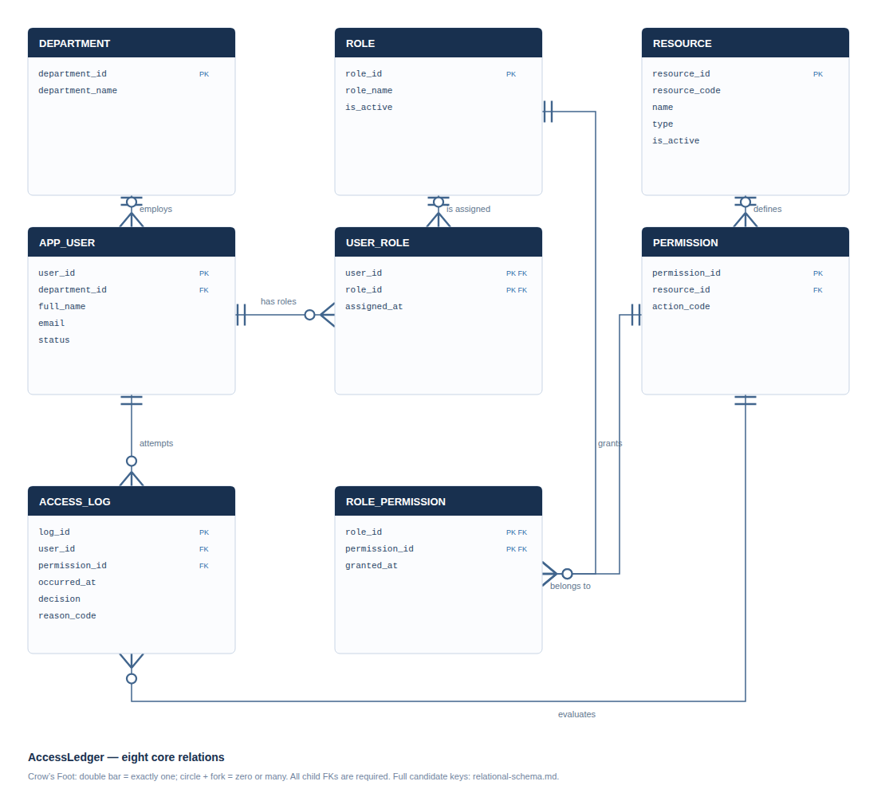
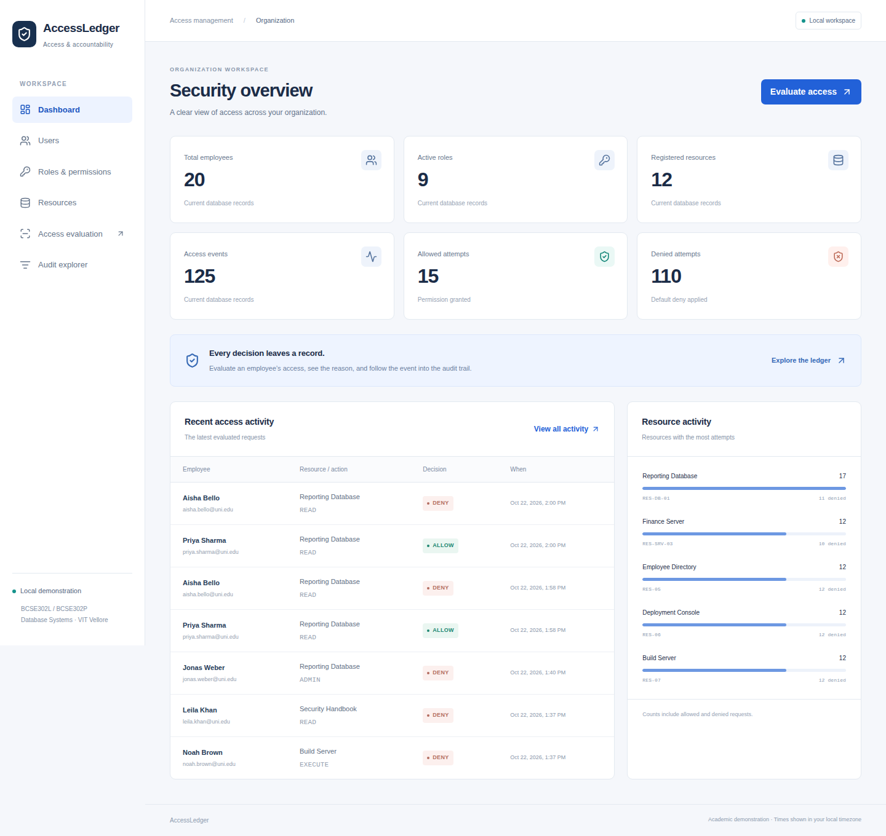
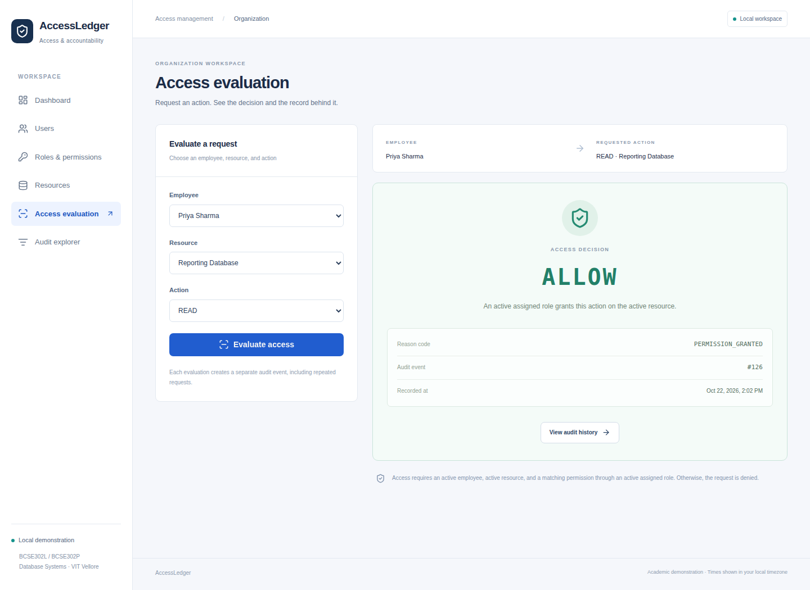
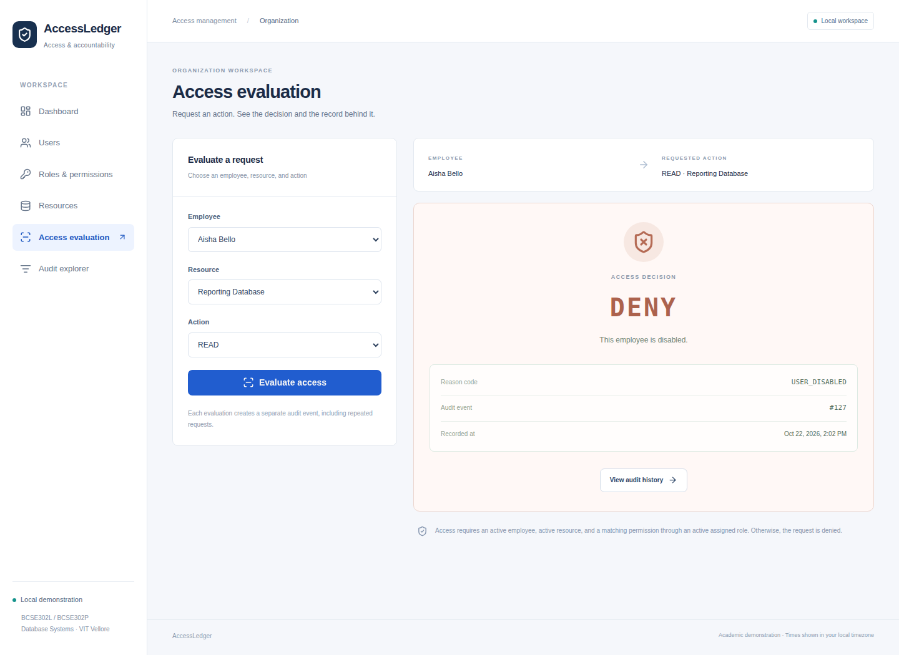
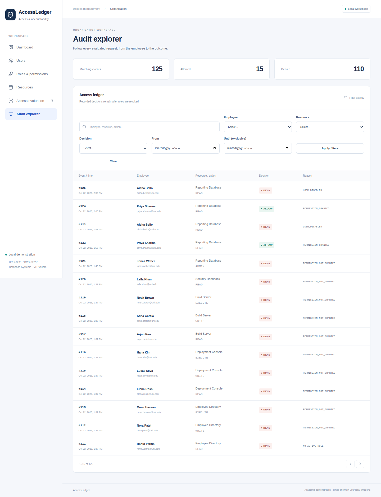

# AccessLedger

A Role-Based Access Control and Security Audit Management System

Academic submission assembled 22 October 2026, 19:53 IST. Evidence timestamps remain explicitly labelled UTC where captured.

## 1. Project Title and Team/Student Details

- Project: AccessLedger
- Institution: VIT Vellore
- Theory course: BCSE302L — Database Systems
- Laboratory: BCSE302P — Database Systems Lab
- Student name(s): [TO BE SUPPLIED BY STUDENT]
- Registration number(s), faculty and review dates: [TO BE SUPPLIED BY STUDENT]

Authority is the user-supplied master requirements and approved plan. The four referenced faculty PDFs were not present; no additional requirements or exact PDF claims are invented. The earlier prototype database and evidence are preserved separately.

## 2. Introduction and Problem Statement

Organizations need a consistent answer to who may perform an action on a protected resource, and a reliable account of attempted access. Individually managing each employee's permissions becomes difficult as responsibilities and resources grow. AccessLedger represents employees, departments, roles, resource actions and assignments in related PostgreSQL relations. Active role paths grant access; all other valid requests are denied and logged.

The primary deliverable is the database: relational integrity, controlled PL/pgSQL business operations, transactional audit recording, concurrency correctness and inspectable SQL. The application makes these concepts demonstrable through connected workflows. It does not enforce access on production resources.

Architecture: React/TypeScript/Vite/Tailwind → FastAPI/Pydantic → SQLAlchemy/Psycopg → PostgreSQL 16. Migrations execute canonical SQL; migration metadata is separate infrastructure. No paid/external service is required.

## 3. Functional Requirements

Register and edit departments/employees; disable users; define and activate/deactivate roles/resources; define unique resource actions; assign/revoke user roles and role permissions; retrieve distinct effective permissions; evaluate access and persist one event; explore filtered/paginated history and aggregate reports.

ALLOW requires an active existing user, existing permission, active associated resource and an active assigned role granting that permission. Valid-reference reason precedence is USER_DISABLED, RESOURCE_INACTIVE, NO_ACTIVE_ROLE, PERMISSION_NOT_GRANTED, then PERMISSION_GRANTED. Invalid user is checked first; invalid user/permission returns an unlogged DENY with a null audit identifier. The browser/API never supplies an authoritative decision or reason.

Included scope is a single trusted local organization. No role inheritance, direct user permissions, federation, SSO, multi-tenancy, approvals, physical access or AI analysis is included. Administrative authentication and production deployment are outside this demonstration.

## 4. ER Diagram



The diagram is generated using the live eight-table catalog. Double bars mean exactly one; circle/fork means zero or many. Each employee belongs to exactly one department. USER_ROLE and ROLE_PERMISSION implement independent many-to-many relationships. ACCESS_LOG references a permission, which determines its resource, avoiding a redundant resource FK in the event.

The editable Mermaid diagram, vector SVG and candidate-key details are delivered alongside this report.

## 5. Relational Schema

Underlined keys are expressed here as PK(...); UK means an additional candidate key.

```text
DEPARTMENT(department_id, department_name)
 PK(department_id), UK(department_name)
APP_USER(user_id, department_id, full_name, email, status)
 PK(user_id), UK(email), FK(department_id) → DEPARTMENT
ROLE(role_id, role_name, is_active)
 PK(role_id), UK(role_name)
USER_ROLE(user_id, role_id, assigned_at)
 PK(user_id, role_id), FK(user_id) → APP_USER, FK(role_id) → ROLE
RESOURCE(resource_id, resource_code, name, type, is_active)
 PK(resource_id), UK(resource_code)
PERMISSION(permission_id, resource_id, action_code)
 PK(permission_id), UK(resource_id, action_code), FK(resource_id) → RESOURCE
ROLE_PERMISSION(role_id, permission_id, granted_at)
 PK(role_id, permission_id), FK(role_id) → ROLE, FK(permission_id) → PERMISSION
ACCESS_LOG(log_id, user_id, permission_id, occurred_at, decision, reason_code)
 PK(log_id), FK(user_id) → APP_USER, FK(permission_id) → PERMISSION
```

All FKs are NOT NULL and ON DELETE RESTRICT. Identity columns supply single-column PKs; timestamp defaults apply to assignments/grants/events. Decision is stored generated and NOT NULL. Status/reason CHECKs and boolean defaults are in the authoritative SQL. Email is normalized before its unique constraint is checked. See database-design.md for sizes and policy rules, normalization.md for FD analysis, and er-diagram.svg for the exported Crow's Foot model.

Normalization analysis: all eight tables are 1NF and 2NF. The first seven satisfy 3NF and BCNF under the listed business dependencies. ACCESS_LOG deliberately retains reason_code → decision: the determinant is not a superkey and decision is not prime, so it violates both 3NF and BCNF. A generated column prevents inconsistent pairs without removing the dependency. Full FDs and candidate keys are documented in normalization.md; no false full-schema 3NF claim is made.

## 6. Table Creation and Constraints

DDL is inspectable in database/schema/001_core_schema.sql, executed by Alembic revision 001. The decision/time index is revision 002. Exactly eight public base tables exist; Alembic version metadata is in infrastructure.

Primary keys include composite junction keys; candidate keys use NOT NULL + UNIQUE. All FKs use ON DELETE RESTRICT. CHECK constraints constrain user status and audit reason. Defaults activate users/roles/resources and timestamp assignments. Identity keys distinguish repeated events. Email is normalized before uniqueness. Required decision is generated from the controlled reason.

Actual fresh seed counts captured from accessledger_test_evidence:

| Relation | Rows |
|---|---:|
| DEPARTMENT | 10 |
| APP_USER | 20 |
| ROLE | 10 |
| USER_ROLE | 34 |
| RESOURCE | 12 |
| PERMISSION | 33 |
| ROLE_PERMISSION | 62 |
| ACCESS_LOG | 120 |

The seed includes disabled users, inactive roles/resources, multiple roles, no-role users, an empty permission role, repeated evaluations and a verified revocation history. Events are produced by evaluate_access, not fabricated decision inserts. Logical relationships are repeatable; event timestamps reflect actual execution.

## 7. SQL Queries and Outputs

The following fifteen queries were executed on the final schema. Excerpts below are copied from actual psql output; the complete unedited output is evidence/current/sql-output.txt. User/department/permission parameters are selectable with psql variables. Additional join, aggregation, subquery and view exercises are retained and executed. The DML demonstration registers, renames and deletes an unused department inside a rolled-back transaction, using a legitimate core entity rather than an extra exercise table.

### Q01 Active employees

```sql
SELECT user_id,full_name,email FROM app_user WHERE status='ACTIVE' ORDER BY user_id;
```

Actual output excerpt ((19 rows)):

```text
user_id |   full_name   |         email         
---------+---------------+-----------------------
       2 | Chen Wei      | chen.wei@uni.edu
       3 | Daniel Okoye  | daniel.okoye@uni.edu
       4 | Fatima Noor   | fatima.noor@uni.edu
       5 | Jonas Weber   | jonas.weber@uni.edu
       6 | Mei Lin Chen  | mei.chen@uni.edu
```
### Q02 Employees by department

```sql
SELECT d.department_name,u.full_name,u.email FROM department d JOIN app_user u USING(department_id) WHERE d.department_id=:department_id ORDER BY u.user_id;
```

Actual output excerpt ((5 rows)):

```text
department_name  |  full_name   |        email         
------------------+--------------+----------------------
 Computer Science | Daniel Okoye | daniel.okoye@uni.edu
 Computer Science | Jonas Weber  | jonas.weber@uni.edu
 Computer Science | Priya Sharma | priya.sharma@uni.edu
 Computer Science | Nora Patel   | nora.patel@uni.edu
 Computer Science | Ethan Lee    | ethan.lee@uni.edu
```
### Q03 Users and assigned roles, including users with no roles

```sql
SELECT u.full_name,r.role_name FROM app_user u LEFT JOIN user_role ur USING(user_id) LEFT JOIN role r USING(role_id) ORDER BY u.user_id,r.role_id;
```

Actual output excerpt ((36 rows)):

```text
full_name   |     role_name     
---------------+-------------------
 Aisha Bello   | Analyst
 Chen Wei      | 
 Daniel Okoye  | Auditor
 Fatima Noor   | Viewer
 Jonas Weber   | Viewer
```
### Q04 Active assigned roles for selected user

```sql
SELECT r.role_id,r.role_name FROM user_role ur JOIN role r USING(role_id) WHERE ur.user_id=:user_id AND r.is_active ORDER BY r.role_id;
```

Actual output excerpt ((2 rows)):

```text
role_id | role_name 
---------+-----------
       1 | Viewer
       2 | Analyst
(2 rows)
```
### Q05 Resource-specific role permissions

```sql
SELECT r.role_name,s.resource_code,p.action_code FROM role r JOIN role_permission rp USING(role_id) JOIN permission p USING(permission_id) JOIN resource s USING(resource_id) ORDER BY r.role_id,p.permission_id;
```

Actual output excerpt ((62 rows)):

```text
role_name        | resource_code | action_code 
------------------------+---------------+-------------
 Viewer                 | RES-DB-01     | READ
 Viewer                 | RES-APP-02    | READ
 Viewer                 | RES-DOC-04    | READ
 Analyst                | RES-DB-01     | READ
 Analyst                | RES-DB-01     | WRITE
```
### Q06 Distinct effective permissions

```sql
SELECT DISTINCT * FROM get_effective_permissions(:user_id);
```

Actual output excerpt ((5 rows)):

```text
permission_id | resource_id | resource_code |    resource_name     | action_code 
---------------+-------------+---------------+----------------------+-------------
             3 |           1 | RES-DB-01     | Reporting Database   | WRITE
             5 |           2 | RES-APP-02    | Internal Application | READ
             2 |           1 | RES-DB-01     | Reporting Database   | READ
             4 |           2 | RES-APP-02    | Internal Application | EXECUTE
             7 |           3 | RES-SRV-03    | Finance Server       | READ
```
### Q07 Users per role, including empty roles

```sql
SELECT r.role_name,count(ur.user_id) AS users FROM role r LEFT JOIN user_role ur USING(role_id) GROUP BY r.role_id ORDER BY r.role_id;
```

Actual output excerpt ((10 rows)):

```text
role_name        | users 
------------------------+-------
 Viewer                 |    15
 Analyst                |    14
 Auditor                |     2
 Administrator          |     1
 Legacy Contractor      |     1
```
### Q08 Roles held by more than two users

```sql
SELECT r.role_name,count(*) AS users FROM role r JOIN user_role ur USING(role_id) GROUP BY r.role_id HAVING count(*)>2 ORDER BY users DESC,r.role_id;
```

Actual output excerpt ((2 rows)):

```text
role_name | users 
-----------+-------
 Viewer    |    15
 Analyst   |    14
(2 rows)
```
### Q09 Users without assigned roles (subquery)

```sql
SELECT u.user_id,u.full_name FROM app_user u WHERE NOT EXISTS(SELECT 1 FROM user_role ur WHERE ur.user_id=u.user_id) ORDER BY u.user_id;
```

Actual output excerpt ((2 rows)):

```text
user_id |  full_name  
---------+-------------
       2 | Chen Wei
       9 | Rahul Verma
(2 rows)
```
### Q10 Denied access attempts

```sql
SELECT * FROM vw_denied_access_attempts ORDER BY occurred_at DESC,log_id DESC;
```

Actual output excerpt ((101 rows)):

```text
log_id |          occurred_at          | decision |      reason_code       | user_id |         email         |   full_name   | department_name  | permission_id | resource_id | resource_code |    resource_name     | resource_type | action_code 
--------+-------------------------------+----------+------------------------+---------+-----------------------+---------------+------------------+---------------+-------------+---------------+----------------------+---------------+-------------
    120 | 2026-10-22 14:13:31.595551+00 | DENY     | PERMISSION_NOT_GRANTED |      18 | leila.khan@uni.edu    | Leila Khan    | Research         |            19 |           8 | RES-08        | Security Handbook    | DOCUMENT      | READ
    119 | 2026-10-22 14:13:31.595454+00 | DENY     | PERMISSION_NOT_GRANTED |      17 | noah.brown@uni.edu    | Noah Brown    | Legal            |            18 |           7 | RES-07        | Build Server         | SERVER        | EXECUTE
    118 | 2026-10-22 14:13:31.595358+00 | DENY     | PERMISSION_NOT_GRANTED |      16 | sofia.garcia@uni.edu  | Sofia Garcia  | Operations       |            17 |           7 | RES-07        | Build Server         | SERVER        | WRITE
    117 | 2026-10-22 14:13:31.595257+00 | DENY     | PERMISSION_NOT_GRANTED |      15 | arjun.rao@uni.edu     | Arjun Rao     | Security         |            16 |           7 | RES-07        | Build Server         | SERVER        | READ
    116 | 2026-10-22 14:13:31.595159+00 | DENY     | PERMISSION_NOT_GRANTED |      14 | hana.kim@uni.edu      | Hana Kim      | Engineering      |            15 |           6 | RES-06        | Deployment Console   | APPLICATION   | EXECUTE
```
### Q11 Denied attempts per user

```sql
SELECT * FROM vw_denied_access_summary ORDER BY denied_attempts DESC,user_id;
```

Actual output excerpt ((20 rows)):

```text
user_id |   full_name   | denied_attempts 
---------+---------------+-----------------
       9 | Rahul Verma   |               7
       1 | Aisha Bello   |               6
       2 | Chen Wei      |               6
       3 | Daniel Okoye  |               6
      12 | Elena Rossi   |               6
```
### Q12 Most frequently accessed resources

```sql
SELECT resource_code,attempts,denied FROM vw_resource_access_summary ORDER BY attempts DESC,resource_id;
```

Actual output excerpt ((12 rows)):

```text
resource_code | attempts | denied 
---------------+----------+--------
 RES-DB-01     |       12 |      9
 RES-SRV-03    |       12 |      7
 RES-05        |       12 |     12
 RES-06        |       12 |     11
 RES-07        |       12 |     12
```
### Q13 Audit history in a selected interval (default: last seven days)

```sql
SELECT * FROM vw_access_audit_history WHERE occurred_at>=:'date_from'::timestamptz AND occurred_at<:'date_to'::timestamptz ORDER BY occurred_at,log_id;
```

Actual output excerpt ((120 rows)):

```text
log_id |          occurred_at          | decision |      reason_code       | user_id |         email         |   full_name   | department_name  | permission_id | resource_id | resource_code |    resource_name     | resource_type | action_code 
--------+-------------------------------+----------+------------------------+---------+-----------------------+---------------+------------------+---------------+-------------+---------------+----------------------+---------------+-------------
      1 | 2026-10-22 14:13:31.549602+00 | ALLOW    | PERMISSION_GRANTED     |       9 | rahul.verma@uni.edu   | Rahul Verma   | Support          |             5 |           2 | RES-APP-02    | Internal Application | APPLICATION   | READ
      2 | 2026-10-22 14:13:31.571302+00 | DENY     | NO_ACTIVE_ROLE         |       9 | rahul.verma@uni.edu   | Rahul Verma   | Support          |             5 |           2 | RES-APP-02    | Internal Application | APPLICATION   | READ
      3 | 2026-10-22 14:13:31.571954+00 | DENY     | USER_DISABLED          |       1 | aisha.bello@uni.edu   | Aisha Bello   | Finance          |             1 |           1 | RES-DB-01     | Reporting Database   | DATABASE      | ADMIN
      4 | 2026-10-22 14:13:31.572308+00 | DENY     | NO_ACTIVE_ROLE         |       2 | chen.wei@uni.edu      | Chen Wei      | Human Resources  |             2 |           1 | RES-DB-01     | Reporting Database   | DATABASE      | READ
      5 | 2026-10-22 14:13:31.5731+00   | DENY     | PERMISSION_NOT_GRANTED |       3 | daniel.okoye@uni.edu  | Daniel Okoye  | Computer Science |             3 |           1 | RES-DB-01     | Reporting Database   | DATABASE      | WRITE
```
### Q14 Users possessing selected permission

```sql
SELECT user_id,full_name,email FROM vw_effective_user_permissions WHERE permission_id=:permission_id ORDER BY user_id;
```

Actual output excerpt ((17 rows)):

```text
user_id |   full_name   |         email         
---------+---------------+-----------------------
       3 | Daniel Okoye  | daniel.okoye@uni.edu
       4 | Fatima Noor   | fatima.noor@uni.edu
       5 | Jonas Weber   | jonas.weber@uni.edu
       6 | Mei Lin Chen  | mei.chen@uni.edu
       7 | Priya Sharma  | priya.sharma@uni.edu
```
### Q15 Complete joined audit report

```sql
SELECT l.log_id,u.full_name,d.department_name,r.resource_code,p.action_code,l.decision,l.reason_code,l.occurred_at FROM access_log l JOIN app_user u USING(user_id) JOIN department d USING(department_id) JOIN permission p USING(permission_id) JOIN resource r USING(resource_id) ORDER BY l.occurred_at,l.log_id;
```

Actual output excerpt ((120 rows)):

```text
log_id |   full_name   | department_name  | resource_code | action_code | decision |      reason_code       |          occurred_at          
--------+---------------+------------------+---------------+-------------+----------+------------------------+-------------------------------
      1 | Rahul Verma   | Support          | RES-APP-02    | READ        | ALLOW    | PERMISSION_GRANTED     | 2026-10-22 14:13:31.549602+00
      2 | Rahul Verma   | Support          | RES-APP-02    | READ        | DENY     | NO_ACTIVE_ROLE         | 2026-10-22 14:13:31.571302+00
      3 | Aisha Bello   | Finance          | RES-DB-01     | ADMIN       | DENY     | USER_DISABLED          | 2026-10-22 14:13:31.571954+00
      4 | Chen Wei      | Human Resources  | RES-DB-01     | READ        | DENY     | NO_ACTIVE_ROLE         | 2026-10-22 14:13:31.572308+00
      5 | Daniel Okoye  | Computer Science | RES-DB-01     | WRITE       | DENY     | PERMISSION_NOT_GRANTED | 2026-10-22 14:13:31.5731+00
```


## 8. Procedures, Functions, Cursor, and Triggers

assign_user_role validates existing active user/role and inserts a unique assignment; revoke_user_role removes the current assignment while preserving old events. grant_role_permission and revoke_role_permission control grants. Additional management and activation routines cover every application mutation path.

evaluate_access obtains a shared transaction advisory lock, checks policy, inserts one event for valid references and returns decision, reason, log ID and timestamp. It is VOLATILE and reads policy after waiting under READ COMMITTED. get_effective_permissions returns distinct current permissions excluding disabled/inactive entities.

generate_access_activity_summary explicitly OPENs a cursor over users, FETCHes each user, calculates total/allowed/denied counts, RETURN NEXTs the report row, and CLOSEs the cursor. It includes zero-event users and creates no report table.

Audit UPDATE/DELETE/TRUNCATE triggers reject modification even for a role allowed to reach them. The application login also lacks these privileges. The permission-identity trigger rejects resource/action changes after a permission is logged. Direct application INSERT into ACCESS_LOG is denied, so clients cannot forge PERMISSION_GRANTED. Safe SECURITY DEFINER ownership/search paths and selective EXECUTE grants complete this boundary. Superuser bypass remains possible and is explicitly not called tamper-proof logging.

Concurrency uses shared advisory transaction lock (302,8) for evaluations and exclusive mode for every controlled policy mutation. READ COMMITTED is enforced. This simple global lock sacrifices unrelated policy-write concurrency in return for a clear auditable protocol; owner maintenance must follow the same protocol. Separate API transactions avoid lock upgrades and commit before returning success.

## 9. Real-World Transaction Demonstrations

Five connected operations are executed using the actual application database login: employee registration, role assignment, permission assignment, evaluation and role revocation followed by reevaluation. API/SQL/table mappings and verification queries are in demonstrations.md. The browser test independently executes the same connected workflow.

Actual controlled SQL demonstration:

```json
{
  "captured_utc": "2026-10-22T14:13:38.933684+00:00",
  "database": "accessledger_test_evidence",
  "actual_login": "accessledger_demo_app",
  "employee_registration": {
    "user_id": 21,
    "department_id": 1
  },
  "role_assignment": {
    "user_id": 21,
    "role_id": 11
  },
  "permission_assignment": {
    "role_id": 11,
    "permission_id": 2,
    "effective_before": [],
    "effective_after": [
      {
        "permission_id": 2,
        "resource_id": 1,
        "resource_code": "RES-DB-01",
        "resource_name": "Reporting Database",
        "action_code": "READ"
      }
    ]
  },
  "evaluation_before_revocation": {
    "decision": "ALLOW",
    "reason_code": "PERMISSION_GRANTED",
    "log_id": 121,
    "occurred_at": "2026-10-22 14:13:38.913449+00:00"
  },
  "evaluation_after_revocation": {
    "decision": "DENY",
    "reason_code": "NO_ACTIVE_ROLE",
    "log_id": 122,
    "occurred_at": "2026-10-22 14:13:38.924156+00:00"
  }
}
```

Both retained joined events are present in demonstrations.json. Removing one of multiple granting roles need not deny access; the demonstration uses a sole-provider role.

Validation results: **85 Python tests passed with 0 failures/errors; 3 browser tests passed**. The suite covers constraints, application-login privileges, owner-level triggers, invalid references, repeated attempts, distinct permissions, rollback and injected audit insertion/commit failure. Eleven two-connection tests prove both lock orders across five mutation types and shared simultaneous evaluations. Full commands/results are captured rather than inferred from source.

Performance uses 100,000 genuine evaluated events on a separate database. Five EXPLAIN (ANALYZE, BUFFERS) runs per configuration show latest-denial median 35.382 ms before and 0.045 ms after the decision/time/log_id index. Other paths use existing indexes; minor timing differences are not attributed to the new index. Full plans and all timings are retained in benchmark.json.









## 10. Conclusion

AccessLedger demonstrates a relational RBAC authorization engine with transactional decision recording and historical retention, backed by inspectable SQL and real integration/concurrency evidence. The API and six-page interface support practical management and access/audit workflows without replacing mandatory database routines with application code.

Reproduction: follow README.md to create a Python environment, install pinned dependencies, bootstrap local PostgreSQL/Node, migrate/seed accessledger_demo and run scripts/dev.sh. Run scripts/verification/run-all.sh for disposable tests, executed SQL, the benchmark and report regeneration. Screenshot capture is a separate explicit live-demo action. No original database reset, remote push or public deployment is performed.

Limits: joined labels are current values, not historical snapshots; policy-change provenance is not stored. Local administrative authentication is outside scope. Docker Compose is provided but unexecuted on this host. Tests use Linux Chromium; other browsers and a formal accessibility audit are not claimed. Benchmark timing is local evidence. Student identity fields must be completed by the student. See requirements.md for the full requirement-to-evidence map and testing.md for warnings and scope limits.
